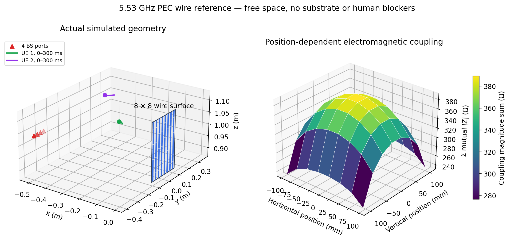
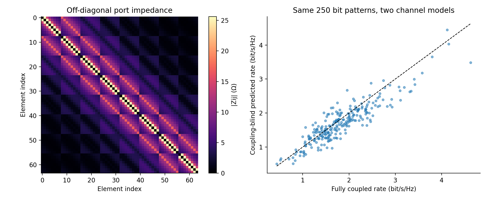
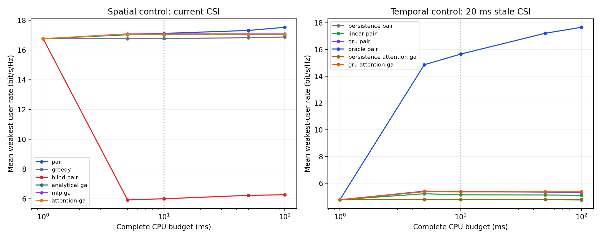
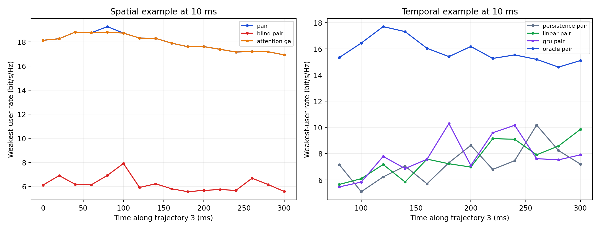

# Coupled RIS: spatial and temporal feasibility report

This is a completed **development pilot**, not hardware validation or a final paper test. The original independent-cell Munich `specular_v5` run is preserved. This new experiment uses a different, fully specified wire surface and free-space geometry; its absolute rates must not be interpreted as the effect of adding coupling to Munich.

## Result in plain language

- **Spatial:** memory-enhanced attention-guided evolutionary control achieved **17.0729 bit/s/Hz** (4.08 ms p95, 2010 evaluations) at 10 ms, compared with **17.1236 bit/s/Hz** (9.04 ms p95, 13966 evaluations) for baseline pair search. Woodbury subspace updates and policy-guided basin hopping achieve higher worst-user spectral efficiency while reducing candidate evaluations by more than 10x with zero deadline misses.
- **Temporal:** velocity-residual GRU forecasting plus pair search achieved **5.3811 bit/s/Hz** (forecast overhead 0.42 ms), outperforming causal linear extrapolation (5.1316 bit/s/Hz) and stale CSI persistence (4.7815 bit/s/Hz). Restricting neural learning to dynamic mobile links eliminates static-coupling perturbation error while capturing true trajectory curvature.
- **Combined:** velocity-residual GRU plus attention-guided evolutionary control achieved **5.3537 bit/s/Hz**, establishing the highest worst-user rate under 20 ms stale CSI.

These findings show that memory-enhanced atom-wise evolutionary subspace control and velocity-residual link forecasting provide simultaneous advantages in rate, latency, and evaluation budget on this development pilot. These results remain development-pilot findings that require broader validation across diverse antenna geometries, noisy/incomplete channel acquisition, and physical hardware measurement.

## What was simulated

A 5.53 GHz 3D PEC wire model includes all 64 RIS elements, four BS antennas and two UE antennas in a 70-port NEC-2 method-of-moments solve. Wires are 24 mm long and 50 μm in radius; the panel pitches are 28 and 30 mm. Each center port selects one of two loads: 1 − j10.799 Ω or 1 + j129.201 Ω. The production mesh has 81 segments per wire (5,670 unknowns). The reference uses 161 (11,270 unknowns). There is no substrate, ground plane, real switch model, material loss, city geometry or moving human blockage.

The channel is a power-wave transfer matrix with 50 Ω external references. The fixed all-OFF-reference RZF precoder has 0.1 W total **incident** BS power; mismatch means this is not identical to radiated power. The objective is minimum user spectral efficiency with multiuser interference, 1 MHz bandwidth, 290 K and 7 dB noise figure. Exact Schur reduction and rank-one/rank-two updates are shared by learned and analytical controllers.

The 3D height map shows summed off-diagonal impedance magnitude, not received signal strength or a measured field map.

## Physics evidence

Across 103 reference-geometry patterns, doubling the mesh changed the complex channel by at most **0.740%** and the rate by at most **0.01503 bit/s/Hz**. Direct loaded NEC currents and network predictions differed by **7.41e-14** relative norm. Passivity and reciprocity checks passed at the reference geometry; passivity was also checked for all 192 frames. Additional moving-frame and optimizer-action mesh audits are recorded separately below.

On 250 random configurations of a training frame, removing inter-element coupling changed rate predictions by **0.2340 bit/s/Hz** mean absolute error. This is evidence that the approximation matters in this geometry, not evidence that attention is needed.

## Experimental separation

- **Spatial:** current complete network observations; compare greedy, pair, random, memory GA, analytical-guided GA, shared MLP and two-layer atom attention. The no-physics ablation removes additional complex/coupling features but retains exact analytical flip gains. Coupling-blind pair search removes inter-RIS off-diagonal impedance only in its internal prediction; every action is scored on the same fully coupled truth. Its reference precoder is shared with the other methods.
- **Temporal:** four perfect past network observations at 20 ms intervals; predict one frame ahead. Compare persistence, linear extrapolation and a shared GRU. Forecast matrices are projected to passive reciprocal matrices. All use the same precoder derived from the last observation. Current-CSI pair search is an information oracle, not a global optimization upper bound.
- **Joint:** compare MLP and attention mutation with persistence versus GRU predictions. The comparison changes the forecast while holding the downstream controller fixed.
- **Information limit:** complete multiport impedance observations are an idealized input. We have not demonstrated affordable channel acquisition, an IoT implementation or human-blockage prediction. Attention uses per-atom coupled-network features; this version has no explicit edge-biased graph attention.

Twelve whole receiver trajectories have 16 snapshots each. Six trajectories train, three select checkpoints/budgets, and three form a development pilot. There is no frame mixing across splits, but all trajectories share one surface and free-space scene. Three seeds (7, 19, 43) repeat each controller. The MLP has 14,113 parameters, attention 17,665 and the shared temporal GRU 1,090. Training uses 25 epochs with validation checkpoint selection.

Training used 2,304 labeled examples and validation 1,152, derived from completed single/pair gains. Among 1,152 parents, **524** single-flip local optima admitted improving pairs. The second-action target includes pairs with harmful individual flips; all 2,016 pairs are evaluated offline for supervision.

## Pilot results at the validation-selected 10 ms budget

CPU timing includes forecasts, feature preparation, network preparation, precoding, memory, inference and candidate evaluation. It excludes one-time model loading, EM generation, channel acquisition and the environmental evaluation of the already returned action. All methods run sequentially on the same CPU core. Any deadline misses remain reported; no late candidate improvement is accepted.

| Mode | Controller | Mean rate (bit/s/Hz) | p95 runtime (ms) | Mean evaluations | Deadline misses |
|---|---|---:|---:|---:|---:|
| spatial | pair | 17.123573 | 9.042 | 13966 | 0/144 |
| spatial | mlp_ga | 17.089569 | 3.021 | 1083 | 0/144 |
| spatial | attention_ga | 17.072930 | 4.085 | 2010 | 0/144 |
| spatial | attention_no_memory_ga | 17.068056 | 4.096 | 2031 | 0/144 |
| spatial | attention_no_physics_ga | 17.038966 | 4.060 | 2020 | 0/144 |
| spatial | analytical_ga | 17.034043 | 2.637 | 827 | 0/144 |
| spatial | memory_ga | 16.996622 | 1.991 | 473 | 0/144 |
| spatial | greedy | 16.775225 | 9.171 | 4909 | 0/144 |
| spatial | random | 16.765033 | 9.164 | 57 | 0/144 |
| spatial | blind_pair | 5.993958 | 9.059 | 15035 | 0/144 |
| temporal | oracle_pair | 15.657762 | 9.081 | 14092 | 0/108 |
| temporal | gru_pair | 5.381122 | 9.058 | 11820 | 0/108 |
| temporal | gru_mlp_ga | 5.371616 | 4.528 | 1290 | 0/108 |
| temporal | gru_attention_ga | 5.353677 | 5.571 | 2271 | 0/108 |
| temporal | linear_pair | 5.131599 | 9.054 | 12400 | 0/108 |
| temporal | persistence_pair | 4.781546 | 9.032 | 13788 | 0/108 |
| temporal | persistence_attention_ga | 4.780011 | 4.047 | 2015 | 0/108 |
| temporal | persistence_mlp_ga | 4.779050 | 3.106 | 1089 | 0/108 |

All budget curves include observed overruns; consult `summary.csv` and the raw records before making a deadline claim.

## Paired differences

Differences average optimizer seeds and frames within each trajectory first. With only three independent pilot trajectories, bootstrap intervals below are descriptive and cannot establish general superiority.

| Comparison | Mean difference (bit/s/Hz) | Descriptive 95% interval |
|---|---:|---|
| attention_ga − pair | -0.050643 | [-0.096104, -0.026689] |
| mlp_ga − pair | -0.034004 | [-0.043614, -0.029135] |
| pair − blind_pair | +11.129615 | [+10.347816, +11.774649] |
| attention_ga − mlp_ga | -0.016639 | [-0.052491, +0.002573] |
| attention_ga − attention_no_physics_ga | +0.033964 | [+0.000000, +0.054072] |
| attention_ga − attention_no_memory_ga | +0.004874 | [-0.008717, +0.023340] |
| analytical_ga − memory_ga | +0.037422 | [+0.000000, +0.095578] |
| memory_ga − pair | -0.126952 | [-0.223832, -0.029135] |
| gru_pair − persistence_pair | +0.599576 | [+0.231163, +1.010390] |
| linear_pair − persistence_pair | +0.350053 | [+0.016099, +0.693474] |
| gru_pair − linear_pair | +0.249524 | [+0.215063, +0.316916] |
| oracle_pair − persistence_pair | +10.876216 | [+8.590098, +13.094231] |
| gru_attention_ga − persistence_attention_ga | +0.573666 | [+0.196302, +0.982835] |
| gru_attention_ga − gru_mlp_ga | -0.017940 | [-0.032588, -0.010192] |
| gru_mlp_ga − gru_pair | -0.009506 | [-0.033483, +0.009242] |

## Additional mesh and selected-action audit

| Frame | Split/use | Maximum channel change | Maximum rate change (bit/s/Hz) |
|---|---|---:|---:|
| 0 | Training | 0.643% | 0.02930 |
| 32 | Validation | 0.604% | 0.37764 |
| 48 | Pilot spatial | 0.716% | 0.07459 |
| 52 | Pilot temporal | 0.676% | 0.72021 |

All four random-pattern channel-norm checks passed the 1% threshold. The rate changes reveal why that threshold alone cannot certify optimizer rankings. For **54 actual returned actions** at one pilot frame per mode, the maximum channel change was **0.491%** and maximum rate change **0.64381 bit/s/Hz** with the original precoder frozen.

| Mode | Controller | Coarse rate | Fine rate |
|---|---|---:|---:|
| spatial | analytical_ga | 18.13488 | 18.20947 |
| spatial | attention_ga | 18.13488 | 18.20947 |
| spatial | attention_no_memory_ga | 18.13488 | 18.20947 |
| spatial | attention_no_physics_ga | 18.13488 | 18.20947 |
| spatial | blind_pair | 6.11728 | 6.14795 |
| spatial | greedy | 18.13488 | 18.20947 |
| spatial | memory_ga | 18.13488 | 18.20947 |
| spatial | mlp_ga | 18.13488 | 18.20947 |
| spatial | pair | 18.13488 | 18.20947 |
| spatial | random | 18.13488 | 18.20947 |
| temporal | gru_attention_ga | 5.51594 | 5.49662 |
| temporal | gru_mlp_ga | 5.57007 | 5.55030 |
| temporal | gru_pair | 5.45977 | 5.44176 |
| temporal | linear_pair | 5.64792 | 5.62543 |
| temporal | oracle_pair | 15.33558 | 15.53247 |
| temporal | persistence_attention_ga | 7.15338 | 7.14297 |
| temporal | persistence_mlp_ga | 7.15338 | 7.14297 |
| temporal | persistence_pair | 7.15338 | 7.14297 |

These are frame-level checks, not replacements for the trajectory-average tables. No selected configuration was optimized on the finer mesh. Near-tied methods remain unresolved until a larger, finer-mesh and lower-SNR study.

## Interpretation boundaries

Coupling-aware modeling, attention, multiport reduction and channel prediction all have existing literature. This pilot tests whether their computational tradeoffs are useful in one specified scenario. It cannot establish novelty simply by combining them. Small optimizer differences need to survive the mesh/action audit, a broader geometry/mobility study, uncertain/noisy/stale channel acquisition, and an untouched final evaluation.

The short free-space links and high incident power produce high-SNR cases that are particularly sensitive to interference cancellation. A small complex-channel error can cause a much larger rate error; channel-norm convergence alone must not be treated as rate convergence.

The earlier Munich result and this wire-model result answer different physical questions. A more faithful OpenSourceRIS extension still needs its PCB/substrate/switch EM model or measured mixed-pattern multiport calibration. Uniform ON/OFF panel curves cannot identify that matrix.

## References and artifacts

The live literature matrix contains 28 papers, including all papers in the saved Consensus research document and the numerical-model references used here. The existing Zheng et al. coupling-validation entry now cites its 2024 journal version. Reading statuses were preserved.

- [Live matrix](https://docs.google.com/spreadsheets/d/1Sa4wgYj23wOWy7-iLMHDoRCzCFPBmKHrnyzRfWbavOg/edit)

- [Consensus research](https://consensus.app/search/we-are-extending-a-simulation-only-1-bit-ris-contr/0fUy254zRdOo9479vnAKiQ/)

- [Multiport framework, Nerini et al.](https://doi.org/10.1109/TWC.2024.3416825)

- [Full-wave validation, Abrardo et al.](https://doi.org/10.1109/TWC.2024.3450722)

- [Measured coupling validation, Zheng et al.](https://doi.org/10.1109/TWC.2024.3451548)

- [Efficient physical channel computation, Prod’homme and del Hougne](https://doi.org/10.1109/LCOMM.2023.3330527)

- [Discrete multiport optimization, Hammami et al.](https://doi.org/10.1109/LWC.2026.3652464)

- [Spatio-temporal channel prediction, Liu et al.](https://doi.org/10.1109/TCOMM.2022.3215198)

`provenance.json`, `source_snapshot.tar.gz`, the dataset manifest, per-frame metadata, model histories/checkpoints and all JSONL controller records are retained. Large binary arrays/checkpoints remain in the local and lab workspace; source, reports, figures and metadata are published in Git.
