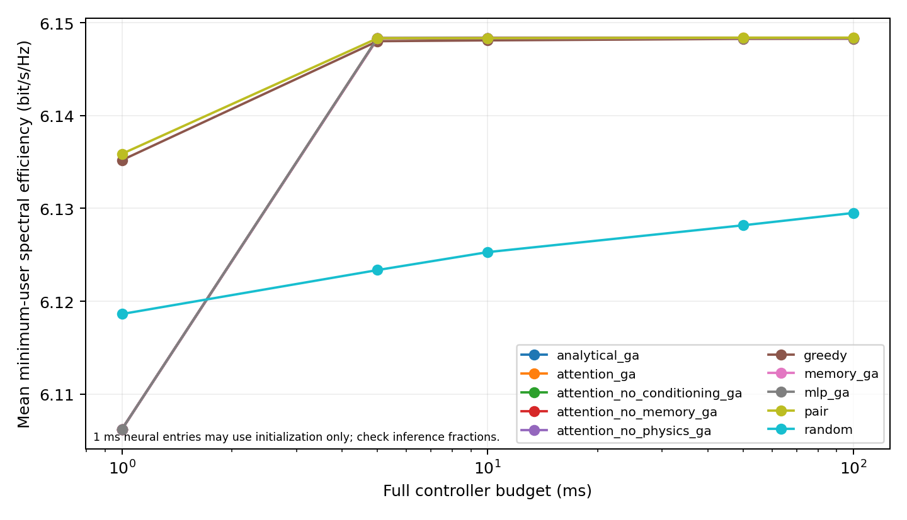

# Simulation-only RIS feasibility report

**Decision: Keep the simpler controller.**

Primary validation-selected budget: **10 ms**. These are development pilot results, not an untouched paper test.

| Controller | Mean worst-user rate (bit/s/Hz) | p95 complete runtime (ms) | Deadline miss fraction | Mean candidate evaluations |
|---|---:|---:|---:|---:|
| mlp_ga | 6.14836508 | 5.603 | 0.000 | 6608.1 |
| attention_no_physics_ga | 6.14836317 | 5.053 | 0.000 | 5848.3 |
| attention_ga | 6.14836604 | 6.670 | 0.000 | 7683.4 |
| memory_ga | 6.14836189 | 3.400 | 0.000 | 4411.0 |
| attention_no_conditioning_ga | 6.14836380 | 5.022 | 0.000 | 5865.0 |
| attention_no_memory_ga | 6.14836225 | 4.707 | 0.000 | 5254.7 |
| analytical_ga | 6.14836400 | 4.754 | 0.000 | 5818.1 |
| random | 6.12528937 | 9.174 | 0.000 | 2648.8 |
| pair | 6.14835756 | 8.823 | 0.000 | 35307.9 |
| greedy | 6.14811631 | 9.153 | 0.000 | 19892.3 |

## Paired trajectory analysis

| Controller | Difference versus pair search | 95% trajectory bootstrap interval |
|---|---:|---|
| analytical_ga | 6.4405019e-06 | [-1.4769144774446412e-05, 3.675343220603071e-05] |
| attention_ga | 8.4812966e-06 | [-8.803617683147044e-06, 3.7177268168018004e-05] |
| attention_no_conditioning_ga | 6.2423057e-06 | [-1.4249082504481773e-05, 3.6753432205919687e-05] |
| attention_no_memory_ga | 4.6938397e-06 | [-1.8894480644770138e-05, 3.675343220591968e-05] |
| attention_no_physics_ga | 5.6100718e-06 | [-1.6145784305335e-05, 3.675343220598136e-05] |
| greedy | -0.00024124983 | [-0.0005529289172684631, -3.9109932661300174e-05] |
| memory_ga | 4.3344751e-06 | [-1.925064678246059e-05, 3.67534322060307e-05] |
| mlp_ga | 7.5172835e-06 | [-1.2191745579185712e-05, 3.7177268168049466e-05] |
| pair | 0 | [0.0, 0.0] |
| random | -0.023068194 | [-0.03864674579883302, -0.00862874330642462] |

## Interpretation limits

- Public Munich geometry, newly traced at nominal 5.53 GHz; exact represented float32 frequency is recorded.
- Independent scalar 8x8 cells. Normal-incidence uniform-panel measurements are extrapolated to a smaller mixed-state array and oblique illumination.
- Cell area is included once via the physical-optics aperture conversion. Mutual coupling, element-specific calibration, and polarization conversion are unmodeled.
- RZF from the all-OFF reference effective channel is fixed within each optimization episode. CSI is exact; channel acquisition and RF switching are outside controller timing.
- The main data use LOS/specular reflections at 5 million rays/source. Diffraction-enabled propagation did not converge sufficiently in the checked settings and is excluded from this first comparison.
- The pilot uses six evaluation trajectories and three paired seeds. This is too small for a final research claim; a future study needs untouched trajectories and more seeds.
- Wall-clock limits are soft CPU deadlines; actual overruns and full timing are reported. All returned improvements were fully evaluated before the internal deadline.
- Pair supervision uses full completed move gains, including harmful first flips. A positive pair-headroom gate alone does not establish a learned speed advantage.
- Large common-phase registration errors can change controller ranking. Fixed-action sensitivity is a stress test, not proof of physical robustness.
- See sensitivity.json, geometry/convergence audits, checkpoint histories, and raw JSONL for evidence. Physical stress envelopes are not measured confidence intervals.

