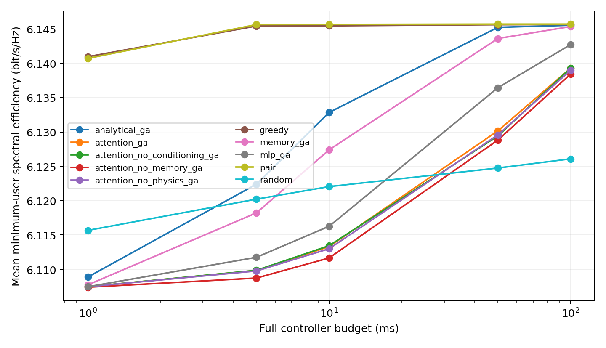

# Simulation-only RIS feasibility report

**Decision: Keep the simpler controller.**

Primary validation-selected budget: **10 ms**. These are development pilot results, not an untouched paper test.

| Controller | Mean worst-user rate (bit/s/Hz) | p95 complete runtime (ms) | Deadline miss fraction |
|---|---:|---:|---:|
| mlp_ga | 6.11627089 | 9.261 | 0.000 |
| attention_no_physics_ga | 6.11299997 | 9.441 | 0.000 |
| attention_ga | 6.11331361 | 9.357 | 0.000 |
| memory_ga | 6.12739740 | 9.708 | 0.000 |
| attention_no_conditioning_ga | 6.11344348 | 9.451 | 0.000 |
| attention_no_memory_ga | 6.11165912 | 9.339 | 0.000 |
| analytical_ga | 6.13284297 | 9.722 | 0.000 |
| random | 6.12204805 | 9.762 | 0.000 |
| pair | 6.14565421 | 9.603 | 0.000 |
| greedy | 6.14545125 | 9.742 | 0.000 |

## Paired trajectory analysis

| Controller | Difference versus pair search | 95% trajectory bootstrap interval |
|---|---:|---|
| analytical_ga | -0.012811239 | [-0.021449836531456018, -0.0041726406969612535] |
| attention_ga | -0.0323406 | [-0.05488268256198242, -0.011471971513800706] |
| attention_no_conditioning_ga | -0.032210729 | [-0.054507835455126115, -0.01157384198687212] |
| attention_no_memory_ga | -0.033995095 | [-0.05694297493174519, -0.012358661163293408] |
| attention_no_physics_ga | -0.03265424 | [-0.05482841031262455, -0.011302927916570232] |
| greedy | -0.00020296493 | [-0.00040470697484197414, -4.6429944796644314e-05] |
| memory_ga | -0.018256808 | [-0.031021493135680794, -0.005748368814556894] |
| mlp_ga | -0.029383319 | [-0.0494564831458783, -0.010288024868996703] |
| pair | 0 | [0.0, 0.0] |
| random | -0.023606165 | [-0.03917081096874341, -0.009156719608867875] |

## Interpretation limits

- Public Munich geometry, newly traced at nominal 5.53 GHz; exact represented float32 frequency is recorded.
- Independent scalar 8x8 cells. Normal-incidence uniform-panel measurements are extrapolated to a smaller mixed-state array and oblique illumination.
- Cell area is included once via the physical-optics aperture conversion. Mutual coupling, element-specific calibration, and polarization conversion are unmodeled.
- RZF from the all-OFF reference effective channel is fixed within each optimization episode. CSI is exact; channel acquisition and RF switching are outside controller timing.
- The main data use LOS/specular reflections at 5 million rays/source. Diffraction-enabled propagation did not converge sufficiently in the checked settings and is excluded from this first comparison.
- The pilot uses six evaluation trajectories and three paired seeds. This is too small for a final research claim; a future study needs untouched trajectories and more seeds.
- Wall-clock limits are soft CPU deadlines; actual overruns and full timing are reported. All returned improvements were fully evaluated before the internal deadline.
- Pair supervision uses full completed move gains, including harmful first flips. A positive pair-headroom gate alone does not establish a learned speed advantage.
- See sensitivity.json, geometry/convergence audits, checkpoint histories, and raw JSONL for evidence. Physical stress envelopes are not measured confidence intervals.

