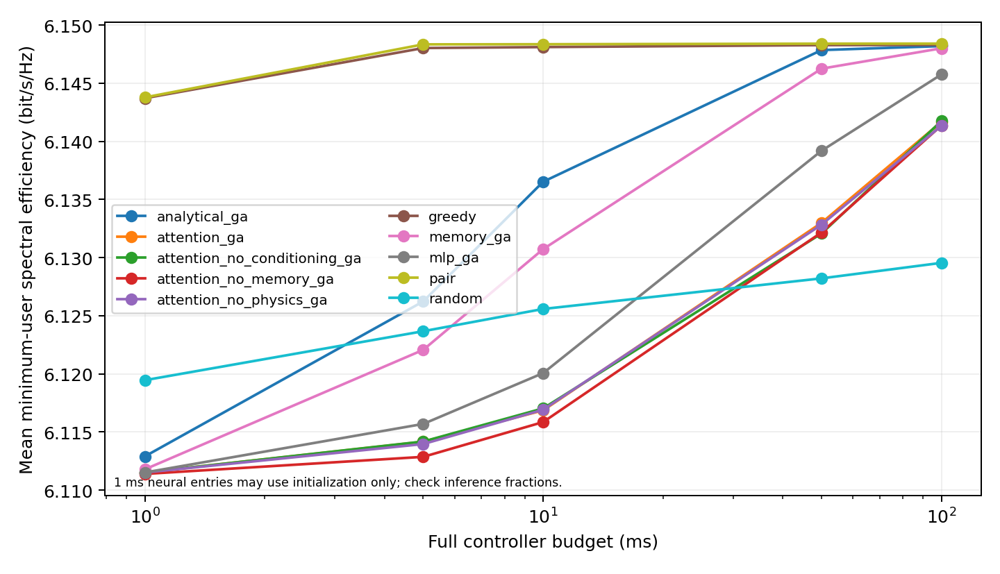

# Simulation-only RIS feasibility report

**Decision: Keep the simpler controller.**

Primary validation-selected budget: **10 ms**. These are development pilot results, not an untouched paper test.

| Controller | Mean worst-user rate (bit/s/Hz) | p95 complete runtime (ms) | Deadline miss fraction |
|---|---:|---:|---:|
| mlp_ga | 6.12006906 | 9.343 | 0.000 |
| attention_no_physics_ga | 6.11691940 | 9.479 | 0.000 |
| attention_ga | 6.11686572 | 9.341 | 0.000 |
| memory_ga | 6.13073290 | 9.712 | 0.000 |
| attention_no_conditioning_ga | 6.11703459 | 9.482 | 0.000 |
| attention_no_memory_ga | 6.11585848 | 9.352 | 0.000 |
| analytical_ga | 6.13652746 | 9.713 | 0.000 |
| random | 6.12558656 | 9.764 | 0.000 |
| pair | 6.14835622 | 9.583 | 0.000 |
| greedy | 6.14811001 | 9.742 | 0.000 |

## Paired trajectory analysis

| Controller | Difference versus pair search | 95% trajectory bootstrap interval |
|---|---:|---|
| analytical_ga | -0.011828761 | [-0.020084705622253642, -0.0035728153939563255] |
| attention_ga | -0.031490498 | [-0.05444392312815862, -0.010490321958319246] |
| attention_no_conditioning_ga | -0.031321634 | [-0.05383292951918248, -0.010703059316721712] |
| attention_no_memory_ga | -0.032497735 | [-0.05498388524865708, -0.010883702811160209] |
| attention_no_physics_ga | -0.031436818 | [-0.0536909486730627, -0.010501841770788561] |
| greedy | -0.00024621394 | [-0.0005477854031202113, -3.9087330662089676e-05] |
| memory_ga | -0.017623315 | [-0.02974359135856251, -0.005616073919472769] |
| mlp_ga | -0.028287162 | [-0.04845274921720149, -0.009182320003544056] |
| pair | 0 | [0.0, 0.0] |
| random | -0.022769663 | [-0.03833909168221124, -0.008614149011106508] |

## Interpretation limits

- Public Munich geometry, newly traced at nominal 5.53 GHz; exact represented float32 frequency is recorded.
- Independent scalar 8x8 cells. Normal-incidence uniform-panel measurements are extrapolated to a smaller mixed-state array and oblique illumination.
- Cell area is included once via the physical-optics aperture conversion. Mutual coupling, element-specific calibration, and polarization conversion are unmodeled.
- RZF from the all-OFF reference effective channel is fixed within each optimization episode. CSI is exact; channel acquisition and RF switching are outside controller timing.
- The main data use LOS/specular reflections at 5 million rays/source. Diffraction-enabled propagation did not converge sufficiently in the checked settings and is excluded from this first comparison.
- The pilot uses six evaluation trajectories and three paired seeds. This is too small for a final research claim; a future study needs untouched trajectories and more seeds.
- Wall-clock limits are soft CPU deadlines; actual overruns and full timing are reported. All returned improvements were fully evaluated before the internal deadline.
- Pair supervision uses full completed move gains, including harmful first flips. A positive pair-headroom gate alone does not establish a learned speed advantage.
- Large common-phase registration errors can change controller ranking. Fixed-action sensitivity is a stress test, not proof of physical robustness.
- See sensitivity.json, geometry/convergence audits, checkpoint histories, and raw JSONL for evidence. Physical stress envelopes are not measured confidence intervals.

